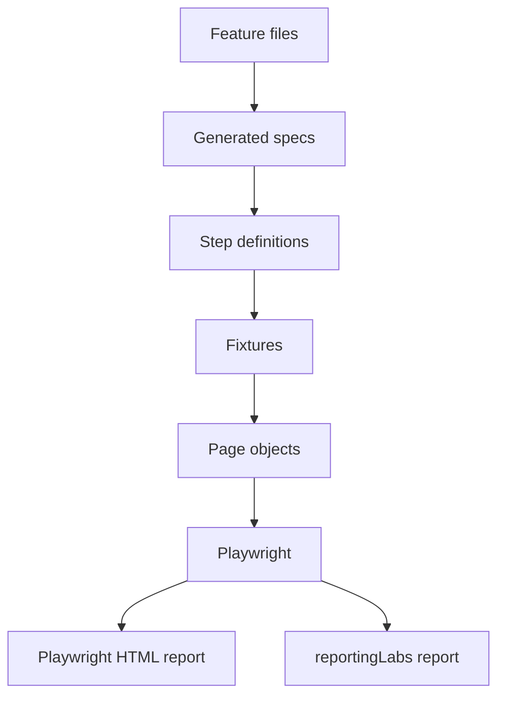

# Playwright + TypeScript + BDD Framework

[](https://github.com/amol9patil/playwright-bdd-framework/actions/workflows/playwright.yml)


This is the framework structure I like to start with when I set up UI automation from scratch:
Playwright and TypeScript, Gherkin scenarios through [playwright-bdd](https://github.com/vitalets/playwright-bdd),
page objects, fixtures, and a pipeline that checks every change. I've worked in test automation for
over ten years, and most of this comes from fixing the same problems on different projects: tests that
only the author can read, locators that break with every UI tweak, flaky runs, and reports nobody opens.

It runs against [SauceDemo](https://www.saucedemo.com), a public practice shop, so anyone can clone it and
run it. It's a personal project. There is no employer or client code, data or credentials in here.

## Where to start

| If you are...                         | Read this first                                                                                                                           |
| ------------------------------------- | ----------------------------------------------------------------------------------------------------------------------------------------- |
| A business stakeholder, BA or manager | [docs/FRAMEWORK_OVERVIEW.md](docs/FRAMEWORK_OVERVIEW.md)                                                                                  |
| A QA lead or delivery manager         | [docs/TEST_STRATEGY.md](docs/TEST_STRATEGY.md) and [docs/TRACEABILITY.md](docs/TRACEABILITY.md)                                           |
| An automation engineer                | [docs/ARCHITECTURE.md](docs/ARCHITECTURE.md), [docs/CODING_STANDARDS.md](docs/CODING_STANDARDS.md) and [CONTRIBUTING.md](CONTRIBUTING.md) |
| Just curious                          | Read the feature files in `features/`. They're plain English                                                                              |

## What's in it

- 22 scenarios (34 test runs per browser, 102 across the three browsers in CI) covering login, inventory, cart, checkout, every SauceDemo account type and one end-to-end purchase journey. Each is tagged with suite, priority and requirement ID
- Page Object Model with custom fixtures, so steps stay short
- User-facing locators (`getByRole`, `getByPlaceholder`, `getByText`), with `getByTestId` as the fallback
- Parallel runs, retries in CI, evidence (screenshot, video, trace) kept for failures only
- Login once per worker with a `storageState` fixture, so scenarios don't repeat the login
- Two reports: Playwright HTML for debugging and [reportingLabs](https://github.com/naveenautomationlabs/reporting-labs) for triage and trend
- Chromium, Firefox and WebKit through a CI build matrix, plus a weekday nightly run and a manual trigger
- Quality gates: pre-commit lint and format, then typecheck, lint and format in the pipeline
- Dependabot, a pull request template and code owners
- A quarantine tag for unstable tests, so they don't block the team
- Known defects of SauceDemo's practice accounts are kept as expected failures (`@fail`), so the suite stays green and the behaviour stays documented

## How the pieces fit



Feature files describe behaviour in business language. Steps are thin: they call a page object and make
the assertion. Page objects own the locators and the clicking and typing. Fixtures give the page objects
to the steps. When the UI changes, I want to fix one page object and nothing else. The longer
explanation, with a sequence diagram and the reasoning behind each choice, is in
[docs/ARCHITECTURE.md](docs/ARCHITECTURE.md).

## Folder layout

```text
features/      Gherkin scenarios
steps/         Step definitions, one file per area
fixtures/      Page objects and the saved login session as fixtures, plus the step registrars
pages/         BasePage and one class per screen
utils/         env.ts, the only place that reads environment variables
environments/  .env.demo, .env.qa and .env.example (templates, no real secrets)
docs/          Overview, strategy, architecture, traceability, standards
.github/       Pipeline, PR template, Dependabot, code owners
.husky/        Pre-commit hook
```

In the project root: `playwright.config.ts` and `reporting-labs.config.ts` (report title, project details, masking and history).

## Running it

You need Node.js 20 or later (`nvm use` picks it up from `.nvmrc`).

```bash
npm ci
npx playwright install chromium
npm test
```

| Command                     | What it does                                                |
| --------------------------- | ----------------------------------------------------------- |
| `npm test`                  | Generates the specs and runs everything on Chromium         |
| `npm run test:smoke`        | Only `@smoke` scenarios                                     |
| `npm run test:regression`   | Only `@regression` scenarios                                |
| `npm run test:all-browsers` | Chromium, Firefox and WebKit (install those browsers first) |
| `npm run test:headed`       | Runs with a visible browser                                 |
| `npm run report`            | Opens the Playwright HTML report                            |
| `npm run verify`            | Typecheck, lint and format check                            |

Run one priority, one journey or one story by tag, for example `npx bddgen && npx playwright test --grep @P0`,
`--grep @e2e` or `--grep @story:CART-02`.

### Environments and credentials

`TEST_ENV` picks `environments/.env.<name>`. The default is `demo`, and `.env.qa` shows the pattern for a second environment. To add one, copy `.env.example`.

```bash
TEST_ENV=qa npm test
```

The demo login in `.env.demo` is the public one printed on the SauceDemo login page. For anything real,
keep credentials in a git-ignored `environments/.env.local` or in pipeline secrets. Never commit them.

## Reports

| Report          | Where                          | Use it for                                                                      |
| --------------- | ------------------------------ | ------------------------------------------------------------------------------- |
| reportingLabs   | `reporting-labs/index.html`    | Status and triage: what failed, how important, new or known, flaky tests, trend |
| Playwright HTML | `playwright-report/index.html` | Debugging one failure: steps, screenshots, video, trace viewer                  |

reportingLabs keeps a history file, so the trend chart and the new-versus-known failures only appear after
two or three runs. It reads the scenario tags: `@P0` to `@P4` for priority, `@story:ID` for traceability,
and `@owner:name` and `@feature:name` for the breakdown charts.

My latest full local run: 102 of 102 green across Chromium, Firefox and WebKit in about two minutes (96 passes and 6 expected failures).

## A scenario

```gherkin
@regression @P1 @story:CART-02
Scenario: Remove a product from the cart
  When the user adds "Sauce Labs Backpack" to the cart
  And the user opens the cart
  And the user removes "Sauce Labs Backpack" from the cart
  Then the cart is empty
```

The Background of the cart feature logs the user in first.

## Choices I made

**Locators.** I try `getByRole`, `getByLabel`, `getByPlaceholder` and `getByText` first, then `getByTestId`.
CSS and XPath are the last resort and need a comment saying why. Locators that mirror what a user sees
survive styling changes much better than class names do.

**No assertions in page objects.** A page object says how to use a page. The step decides what must be
true. Mixing the two makes page objects hard to reuse.

**Log in once per worker, not once per scenario.** A worker-scoped fixture logs in through the UI, saves the
session with `storageState`, and scenarios that say "the user is logged in" load it. Scenarios stay
independent (each gets a fresh browser context), and the login screen is still tested properly because
those scenarios never ask for the saved session.

**Business setup stays in the Gherkin.** I haven't needed Before/After hooks here. Setup like logging in sits in a
Background step, where everyone can read it, instead of hiding in a hook.

**No hard waits.** Playwright's auto-waiting and web-first assertions cover almost everything. ESLint blocks
`waitForTimeout`, `networkidle` and `force: true`, because those are behind most flaky suites I've had to fix.

**Flaky tests are a defect.** They get flagged, owned and either fixed or quarantined. The policy is in
[docs/TEST_STRATEGY.md](docs/TEST_STRATEGY.md).

## Still to do

- API checks next to the UI flows
- Accessibility checks with axe
- Docker image for identical local and CI runs

## Author

Amol Patil, test automation engineer with 10+ years of experience.

[LinkedIn](https://www.linkedin.com/in/amol9patilap) | [Medium](https://medium.com/@amol9patil) | [GitHub](https://github.com/amol9patil)

## License

MIT
