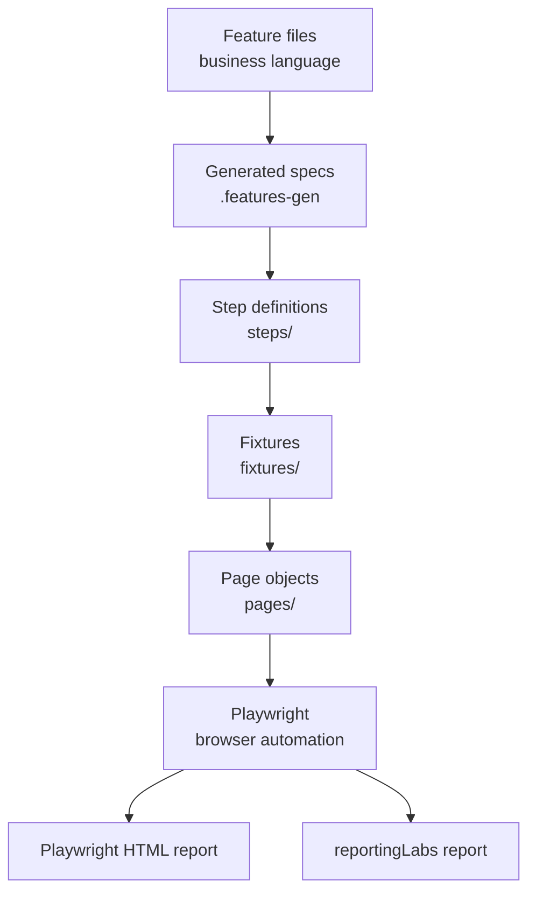
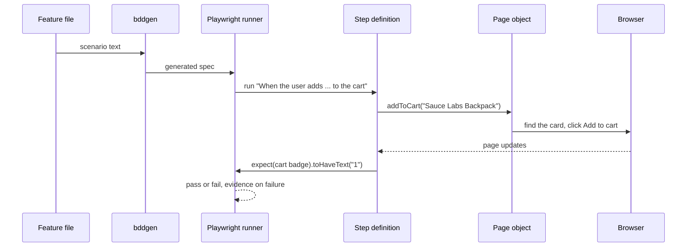

# Architecture

How the framework is put together and why. If you only need the business view, read
[FRAMEWORK_OVERVIEW.md](FRAMEWORK_OVERVIEW.md) first.

## Layers



| Layer            | Folder                                            | Job                                                                 | Who edits it   |
| ---------------- | ------------------------------------------------- | ------------------------------------------------------------------- | -------------- |
| Feature files    | `features/`                                       | Describe behaviour in Given/When/Then                               | BA, QA         |
| Generated specs  | `.features-gen/`                                  | Created by `bddgen` from the features. Never edited by hand         | Nobody         |
| Step definitions | `steps/`                                          | Translate a sentence into a page-object call and make the assertion | QA engineer    |
| Fixtures         | `fixtures/`                                       | Create the page objects and give them to the steps                  | Test architect |
| Page objects     | `pages/`                                          | Own the locators and the clicking and typing for one screen         | QA engineer    |
| Config and utils | `playwright.config.ts`, `utils/`, `environments/` | Runner settings, environments, helpers                              | Test architect |

## What happens when one scenario runs



## Folder layout

```text
features/      Gherkin scenarios, one file per business area
steps/         Step definitions, one file per area
fixtures/      Page objects as fixtures, Given/When/Then registrars
pages/         BasePage and one class per screen
utils/         env.ts, the only place that reads environment variables
environments/  .env.demo, .env.qa, .env.example and, locally, a private .env.local
reporting-labs.config.ts  Report settings (title, project, masking, history)
docs/          Strategy, architecture, standards, traceability
.github/       Pipeline, pull request template, Dependabot, code owners
.husky/        Pre-commit hook (lint-staged)
```

## Design decisions

| Decision                               | Why                                                                                                                       | What it costs                                                                                                                      |
| -------------------------------------- | ------------------------------------------------------------------------------------------------------------------------- | ---------------------------------------------------------------------------------------------------------------------------------- |
| Playwright over Selenium               | Auto-waiting, built-in traces, multi-browser support, fast parallel runs                                                  | Smaller pool of legacy examples                                                                                                    |
| BDD with `playwright-bdd`              | Keeps the normal Playwright runner, fixtures and retries while adding Gherkin                                             | An extra generation step (`bddgen`)                                                                                                |
| Page Object Model                      | A UI change is fixed in one place                                                                                         | Some upfront structure for small suites                                                                                            |
| Role-based locators first              | They match what a user sees, so styling changes don't break them                                                          | Needs reasonable accessibility markup, falls back to test ids                                                                      |
| Assertions in steps, not pages         | Pages stay reusable, and a step says what must be true                                                                    | Slightly more code in the steps                                                                                                    |
| Login once per worker (`storageState`) | Most of the run time was repeated logins. Each scenario still gets a fresh browser context, so scenarios stay independent | The first scenario on each worker pays for the login. Apps that keep a token in local storage need the saved `origins` applied too |
| Setup in Gherkin, not in hooks         | A reader of the feature file sees how every scenario starts, with nothing hidden in a Before hook                         | A little repetition in Backgrounds. I'd add a hook only for technical housekeeping                                                 |
| No hard waits (lint-enforced)          | Hard waits are behind most flaky suites                                                                                   | Developers must learn web-first assertions                                                                                         |
| Two reports                            | Managers and engineers need different views                                                                               | One more thing to publish                                                                                                          |
| Evidence only on failure               | Saves time and storage                                                                                                    | Passing runs have no video to review                                                                                               |
| Build matrix in CI                     | Cross-browser coverage without slowing local runs                                                                         | More pipeline minutes                                                                                                              |

## Quality gates

Before code reaches `main`:

1. **Pre-commit** (Husky and lint-staged) lints and formats the changed files.
2. **Pull request** runs `npm run verify` (typecheck, lint, format) and the test matrix.
3. **Review** by a code owner, using the checklist in the pull request template.

## Extending it

- New screen: add a page object, register it in `customFixtures.ts`.
- New behaviour: write the scenario, reuse existing steps, add steps only for new wording.
- New browser or device: add an entry to `projects` in `playwright.config.ts`.
- New environment: add `environments/.env.<name>` and run with `TEST_ENV=<name>`.
